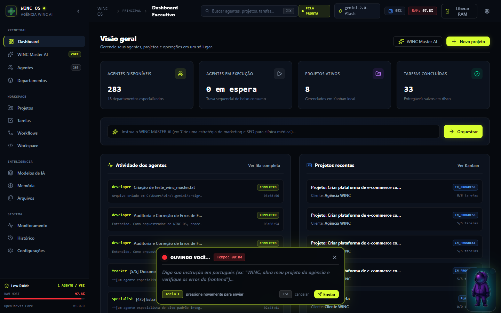
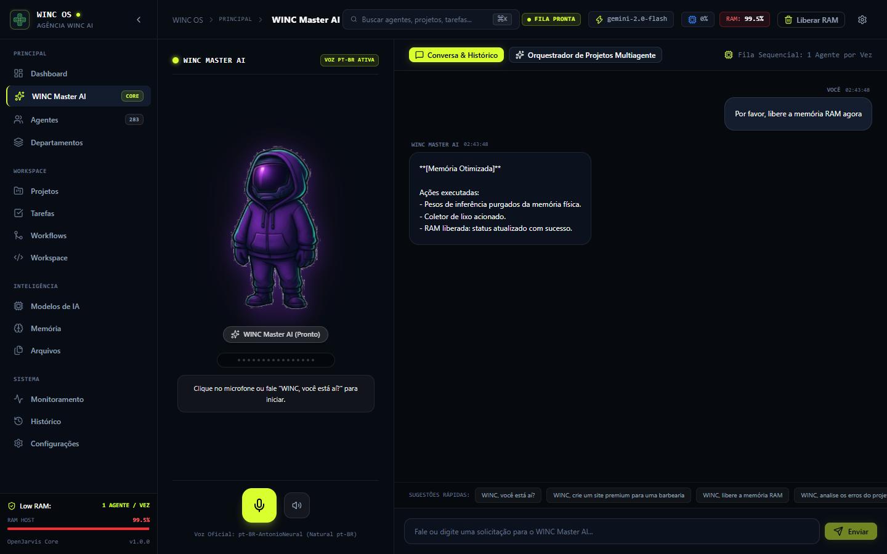
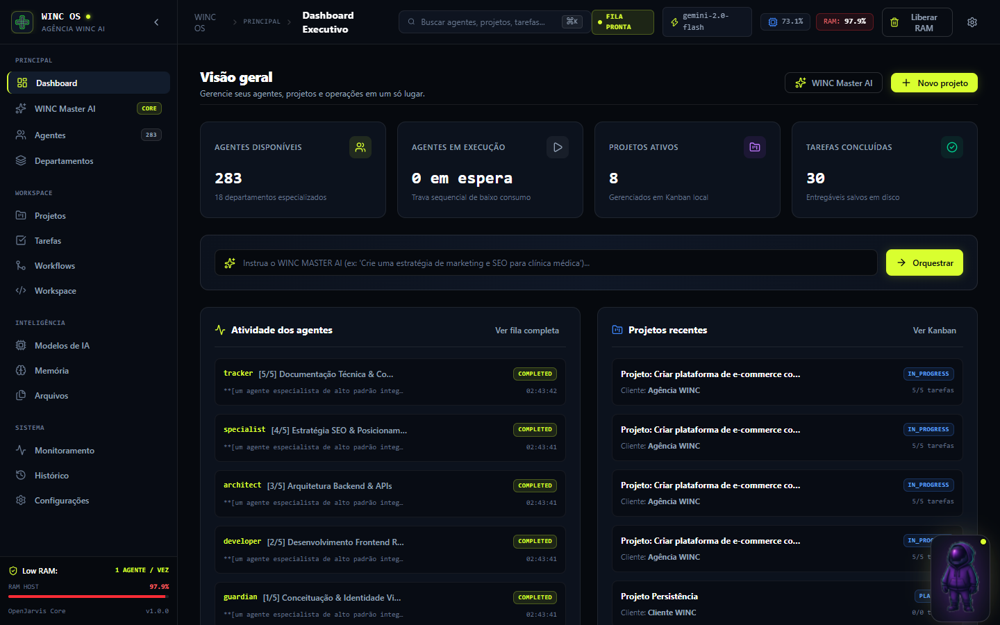
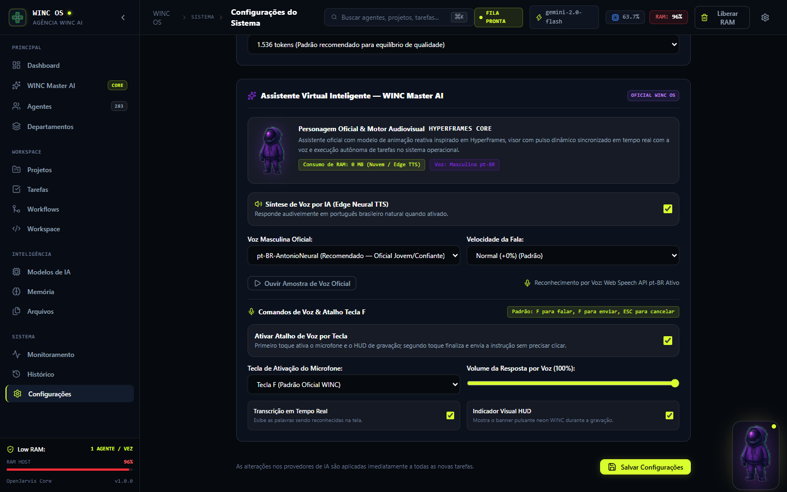

# WINC AI OS — Sistema Operacional de Agentes Inteligentes

<p align="center">
  
</p>

<p align="center">
  <b>Sistema Operacional Desktop de Inteligência Artificial da Agência WINC</b><br>
  <i>Combinando a biblioteca multidisciplinar do <b>Agency Agents</b> (283 especialistas em 18 departamentos) com a infraestrutura do <b>OpenJarvis</b> e animação reativa <b>HyperFrames</b>.</i>
</p>

<p align="center">
  
  
  
  
</p>

---

## 🌟 Principais Destaques

- **WINC Master AI com Controle por Voz pela Tecla F:**
  - Pressione **F** em qualquer tela do sistema para ativar o microfone e exibir o HUD neon flutuante com timer em tempo real.
  - Pressione **F novamente** para finalizar a gravação e enviar automaticamente a instrução para execução, sem necessidade de clicar em botões.
  - Pressione **ESC** a qualquer momento para cancelar a gravação imediatamente.
  - Proteção inteligente: a tecla F é ignorada durante a digitação em campos de texto (`<input>`, `<textarea>`) e eventos mantidos pressionados (`event.repeat`) são bloqueados.
- **Voz Masculina Oficial em Português Brasileiro (pt-BR):**
  - Síntese neural de alta qualidade via `pt-BR-AntonioNeural` (Edge Neural TTS), com dicção jovem-adulta, tom médio-grave confiante e cache persistente em disco.
- **Animação Audiovisual Reativa (Inspirada no HyperFrames):**
  - Personagem oficial em alta definição sem boca humana (capacete fechado).
  - Luminescência e oscilação reativa do visor e da aura holográfica calculadas em tempo real pela amplitude do áudio (`Web Audio API`).
- **Catálogo de 283 Agentes Especializados (Agency Agents):**
  - 18 departamentos técnicos (Engenharia de Software, Marketing, Design, Jogos, Segurança, Finanças, etc.).
  - Localização 100% em Português Brasileiro (pt-BR) com busca bilíngue.
- **Arquitetura Low RAM (Ambiente 4 GB de RAM Física):**
  - Trava estrita de execução exclusiva: **1 agente por vez** em fila sequencial FIFO.
  - Zero sobrecarga de memória RAM local ao utilizar modelos remotos (Google Gemini API / OpenRouter).
  - Descarregamento automático de pesos de inferência e coleta periódica de lixo de memória.
- **14 Painéis Executivos Integrados:**
  - Dashboard Executivo, WINC Master AI Core, Catálogo de Agentes, Departamentos, Projetos (Kanban), Tarefas, Workflows (DAG), Workspace com Terminal, Modelos de IA, Memória Persistente, Central de Arquivos, Monitoramento & Telemetria, Histórico de Auditoria e Configurações.

---

## 🖥️ Evidências Visuais

| Controle por Voz (Tecla F) | WINC Master AI (Hero & Waveform) |
|---|---|
|  |  |

| Dashboard Executivo & Assistente Flutuante | Configurações do Atalho de Voz |
|---|---|
|  |  |

---

## 🚀 Como Iniciar com 1 Clique no Windows

1. Dê um duplo-clique no arquivo:
   ```cmd
   start_winc_os.bat
   ```
2. O launcher verificará a memória RAM, iniciará o servidor backend e abrirá seu navegador padrão em:
   ```
   http://127.0.0.1:8000
   ```

### Inicialização Manual via Terminal:

```powershell
# 1. Definir caminhos de bibliotecas
$env:PYTHONPATH = "backend;openjarvis/src"

# 2. Iniciar servidor FastAPI com Uvicorn
python -m uvicorn app.main:app --host 127.0.0.1 --port 8000
```

---

## 🗣️ Guia Rápido de Comandos por Voz (Tecla F)

Pressione **F**, fale seu comando e pressione **F** novamente:

- *"WINC, você está funcionando?"*  
  $\rightarrow$ Responde verbalmente confirmando 100% de prontidão do sistema e dos 283 especialistas.
- *"WINC, abra meu projeto da agência e verifique os erros do frontend."*  
  $\rightarrow$ Aloca o Especialista em Frontend na fila sequencial FIFO e inicia a auditoria.
- *"WINC, crie um arquivo de teste no meu projeto."*  
  $\rightarrow$ Grava fisicamente em disco o arquivo `teste_winc_master.txt` em `storage/workspace/`.
- *"WINC, qual é o status dos meus projetos?"*  
  $\rightarrow$ Consulta o SQLite e informa o total de projetos e tarefas em andamento.
- *"WINC, libere a memória RAM agora."*  
  $\rightarrow$ Descarrega pesos de modelos e purga a memória do sistema operacional.
- *"WINC, crie uma landing page para barbearia com agendamento."*  
  $\rightarrow$ Decompõe em tarefas multiagente (Design, Frontend, Backend e SEO) e enfileira na trava sequencial.

---

## 🧪 Bateria de Testes Automatizados

O sistema inclui suítes completas de testes de integração:

```powershell
# Executar todos os testes de integração do sistema (15/15)
python tests/run_all_tests.py

# Executar bateria de testes do atalho Tecla F e Master AI (12/12)
python tests/test_key_f_and_voice.py
```

---

## 📄 Licença e Créditos

- **WINC AI OS** desenvolvido para a **Agência WINC**.
- Especialistas baseados no catálogo do [Agency Agents](https://github.com/msitarzewski/agency-agents).
- Motor de orquestração baseado no [OpenJarvis](https://github.com/open-jarvis/OpenJarvis).
- Conceitos de animação inspirados no [HyperFrames](https://github.com/heygen-com/hyperframes).
